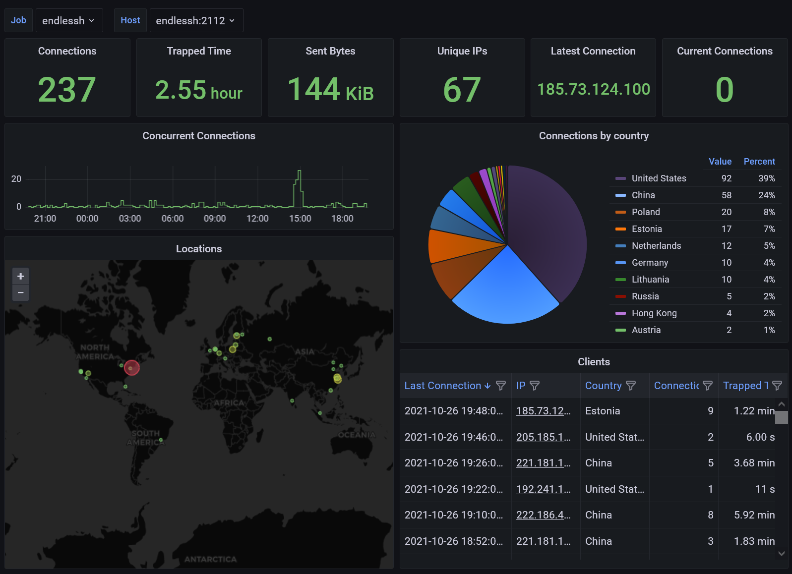

# endlessh-go

[](https://github.com/shizunge/endlessh-go/releases/latest)
[](https://github.com/shizunge/endlessh-go/blob/main/LICENSE)
[](https://hub.docker.com/r/dalbodeule/endlessh-go)
[](https://hub.docker.com/r/dalbodeule/endlessh-go)
[](https://github.com/dalbodeule/endlessh-go/actions/workflows/on-push.yml)
[](https://www.codefactor.io/repository/github/shizunge/endlessh-go)

A golang implementation of [endlessh](https://nullprogram.com/blog/2019/03/22/) exporting Prometheus metrics, visualized by a Grafana dashboard.



## Introduction

[Endlessh](https://nullprogram.com/blog/2019/03/22/) is a great idea that not only blocks the brute force SSH attacks, but also wastes attackers time as a kind of counter-attack. Besides trapping the attackers, I also want to visualize the Geolocations and other statistics of the sources of attacks. Unfortunately the wonderful original [C implementation of endlessh](https://github.com/skeeto/endlessh) only provides text based log, but I do not like the solution that writes extra scripts to parse the log outputs, then exports the results to a dashboard, because it would introduce extra layers in my current setup and it would depend on the format of the text log file rather than some structured data. Thus I create this golang implementation of endlessh to export [Prometheus](https://prometheus.io/) metrics and a [Grafana](https://grafana.com/) dashboard to visualize them.

If you want a dashboard of attack sources, the server can also translate IP addresses to geohashes and export Prometheus metrics. These options use additional memory; the amount depends on how many IPs and ports are tracked.

## Getting Started

Clone the repo then build from source:

```
go build .
./endlessh-go &
```

Alternatively, you can use the [docker image](https://hub.docker.com/r/shizunge/endlessh-go):

```
docker run -d -p 2222:2222 shizunge/endlessh-go -logtostderr -v=1
```

It listens to port `2222` by default.

Then you can try to connect to the endlessh server. Your SSH client should hang there.

```
ssh -p 2222 localhost
```

If you want log like the [C implementation](https://github.com/skeeto/endlessh), you need to set both CLI arguments `-logtostderr` and `-v=1`, then the log will go to stderr. You can set different log destinations via CLI arguments.

Also check out [examples](./examples/README.md) for the setup of the full stack.

## Usage

`./endlessh-go --help`

```
Usage of ./endlessh-go
  -alsologtostderr
        log to standard error as well as files
  -conn_type string
        Connection type. Possible values are tcp, tcp4, tcp6 (default "tcp")
  -enable_prometheus
        Enable prometheus (deprecated, use prometheus_enabled)
  -geoip_supplier string
        Supplier to obtain Geohash of IPs. Possible values are "off", "ip-api", "max-mind-db" (default "off")
  -healthcheck
        Perform healthcheck and exit. GET healthcheck_host:healthcheck_port/health and exit 1 if status is not ok or timeout is exceeded.
  -healthcheck_enabled
        Enable healthcheck
  -healthcheck_host string
        The address for healthcheck. (default "127.0.0.1")
  -healthcheck_port string
        HTTP port for healthcheck; Serves JSON with status and uptime at /health. (default "51000")
  -host string
        SSH listening address (default "0.0.0.0")
  -interval_ms int
        Message millisecond delay (default 1000)
  -line_length int
        Maximum banner line length (default 32)
  -log_backtrace_at value
        when logging hits line file:N, emit a stack trace
  -log_dir string
        If non-empty, write log files in this directory
  -log_link string
        If non-empty, add symbolic links in this directory to the log files
  -logbuflevel int
        Buffer log messages logged at this level or lower (-1 means don't buffer; 0 means buffer INFO only; ...). Has limited applicability on non-prod platforms.
  -logtostderr
        log to standard error instead of files
  -max_clients int
        Maximum number of clients (default 4096)
  -max_mind_db string
        Path to the MaxMind DB file.
  -port value
        SSH listening port. You may provide multiple -port flags to listen to multiple ports. (default "2222")
  -prometheus_clean_unseen_seconds int
        Remove per-IP series if the IP is not seen for the given number of seconds. Set to 0 to disable. (default 3600)
  -prometheus_enabled
        Enable prometheus
  -prometheus_entry string
        Entry point for prometheus (default "metrics")
  -prometheus_host string
        The address for prometheus (default "0.0.0.0")
  -prometheus_max_tracked_ips int
        Maximum number of IPs retained in per-IP Prometheus metrics (default 10000)
  -prometheus_port string
        The port for prometheus (default "2112")
  -proxy_protocol_enabled
        Enable PROXY protocol support. This causes the server to expect PROXY protocol headers on incoming connections.
  -proxy_protocol_read_header_timeout_ms int
        Timeout for reading the PROXY protocol header in milliseconds. If the connection does not send a valid PROXY protocol header in this time, the header is ignored. (default 200)
  -stderrthreshold value
        logs at or above this threshold go to stderr (default 2)
  -tcp_keepalive_count int
        Number of unanswered TCP keepalive probes before closing (default 3)
  -tcp_keepalive_idle_seconds int
        Seconds of TCP inactivity before the first keepalive probe (default 30)
  -tcp_keepalive_interval_seconds int
        Seconds between TCP keepalive probes (default 10)
  -tcp_read_buffer_bytes int
        TCP receive buffer size in bytes; 0 uses the system default (default 16384)
  -tcp_user_timeout_ms int
        Linux: maximum milliseconds of unacknowledged TCP data; 0 uses the system default (default 60000)
  -tcp_write_buffer_bytes int
        TCP send buffer size in bytes; 0 uses the system default (default 16384)
  -tcp_write_timeout_ms int
        Maximum milliseconds a TCP write may wait for a slow peer (default 5000)
  -v value
        log level for V logs
  -vmodule value
        comma-separated list of pattern=N settings for file-filtered logging
```

## TCP sockets

The SSH tarpit uses TCP keepalive on every accepted connection, including connections received through the PROXY protocol. The defaults start probing after 30 seconds of inactivity, then send up to three probes 10 seconds apart. The receive and send buffers are requested at 16 KiB each to limit kernel memory held by clients that do not read or that send excessive data; the operating system may adjust the actual sizes. On Linux, `TCP_USER_TIMEOUT` is set to 60 seconds so unacknowledged or unsent data cannot keep a dead connection open for the system's much longer default timeout ([Linux tcp(7)](https://man7.org/linux/man-pages/man7/tcp.7.html)). Set `-tcp_user_timeout_ms=0` to use the Linux system default. This option has no effect on other operating systems. TCP sockets already use Go's nonblocking network poller and have `TCP_NODELAY` enabled by default. Each write is also capped by `-tcp_write_timeout_ms` when the banner interval is longer than that timeout. These settings apply only to the SSH tarpit listener, not the HTTP healthcheck or Prometheus listeners.

## Metrics

Endlessh-go exports the following Prometheus metrics.

| Metric                               | Type  | Description  |
|--------------------------------------|-------|--------------|
| endlessh_client_open_count_total     | count | Total number of clients that tried to connect to this host. |
| endlessh_client_closed_count_total   | count | Total number of clients that stopped connecting to this host. |
| endlessh_sent_bytes_total            | count | Total bytes sent to clients that tried to connect to this host. |
| endlessh_trapped_time_seconds_total  | count | Total seconds clients spent on endlessh. |
| endlessh_client_open_count           | count | Number of connections of clients. <br> Labels: <br> <ul><li> `ip`: Remote IP of the client </li> <li> `local_port`: Local port the program listens to </li> <li> `country`: Country of the IP </li> <li> `location`: Country, Region, and City </li> <li> `geohash`: Geohash of the location </li></ul> |
| endlessh_client_trapped_time_seconds | count | Seconds a client spends on endlessh. <br> Labels: <br> <ul><li> `ip`: Remote IP of the client </li> <li> `local_port`: Local port the program listens to </li></ul> |

The metrics is off by default, you can turn it via the CLI argument `-prometheus_enabled`.

It listens to port `2112` and entry point is `/metrics` by default. The port and entry point can be changed via CLI arguments.

Per-IP metrics are removed after one hour without activity by default. The `-prometheus_clean_unseen_seconds` flag controls that period, and `-prometheus_max_tracked_ips` caps the number of IPs retained at 10,000 by default. When the cap is reached, the oldest IP's per-IP series are removed; aggregate counters remain available. GeoIP results are reused while an IP remains tracked. External GeoIP lookups run in a bounded worker pool so they cannot block connection and aggregate metric recording. Per-IP metrics appear once lookup finishes; if the lookup queue is full, the IP is recorded with unknown location.

The endlessh-go server stores the geohash of attackers as a label on `endlessh_client_open_count`, which is also off by default. You can turn it on via the CLI argument `-geoip_supplier`. The endlessh-go uses service from [ip-api](https://ip-api.com/), which may enforce a query rate and limit commercial use. Visit their website for their terms and policies.

You could also use an offline GeoIP database from [MaxMind](https://www.maxmind.com) by setting `-geoip_supplier` to _max-mind-db_ and `-max_mind_db` to the path of the database file.

## Healthcheck

The endlessh-go server exposes an HTTP health endpoint when the `-healthcheck_enabled` flag is set. By default it listens on `127.0.0.1:51000` at `/health` and returns a JSON like this:

```json
{
      "status": "ok",
      "uptime": 123.456789012
}
```

`status` is always "ok".

`uptime` is the number of seconds since the server started. The host and port can be changed via `-healthcheck_host` and `-healthcheck_port`.

The [docker image](https://hub.docker.com/r/shizunge/endlessh-go) includes a built-in `HEALTHCHECK` that runs `/endlessh -healthcheck` every 30 seconds. No shell, curl, or wget is needed. If you override the image's default `CMD` in Docker Compose or `docker run`, include `-healthcheck_enabled` in the new command. The health endpoint is bound to loopback by default, so it is available to the built-in check inside the container without exposing port 51000 on the host. If you change `-healthcheck_port`, also override the Docker healthcheck command with the same port, for example `test: ["CMD", "/endlessh", "-healthcheck", "-healthcheck_port=50000"]` in Compose.

## Dashboard

The dashboard requires Grafana 8.2.

You can import the dashboard from Grafana.com using ID [15156](https://grafana.com/grafana/dashboards/15156)

The dashboard visualizes data for the selected time range.

The IP addresses are clickable and link you to the [ARIN](https://www.arin.net/) database.

## Contacts

If you have any problems or questions, please contact me through a [GitHub issue](https://github.com/shizunge/endlessh-go/issues)
